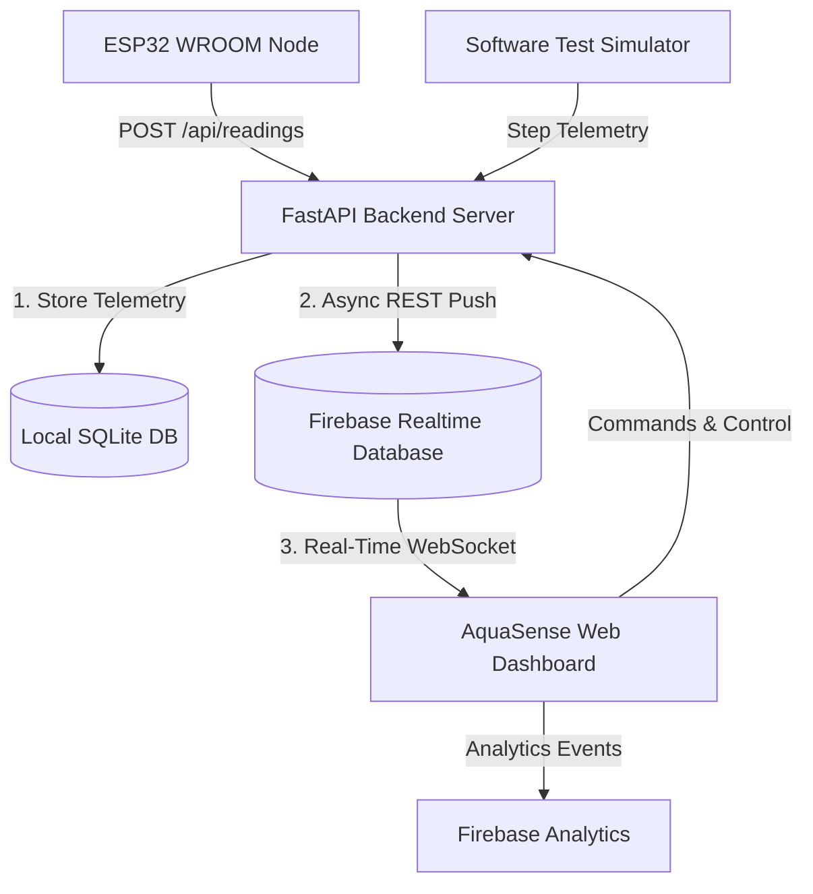

# AquaSense Firebase Cloud Integration Guide

This document describes how Firebase Realtime Database (RTDB) and Google Analytics are integrated into the AquaSense Precision Agriculture platform.

---

## 1. Firebase Project Overview

* **Project ID**: `aquasense-62dda`
* **Realtime Database Region**: `asia-southeast1` (Singapore)
* **Realtime Database URL**: `https://aquasense-62dda-default-rtdb.asia-southeast1.firebasedatabase.app`
* **Firebase Console Link**:
  [Open AquaSense Firebase Console](https://console.firebase.google.com/u/0/project/aquasense-62dda/database/aquasense-62dda-default-rtdb/data/~2F)

---

## 2. Realtime Database Data Schema

The database is structured under the `/aquasense` namespace:

```
aquasense/
├── cloud_meta/                  # Connection status and metadata
├── telemetry/
│   └── latest/                  # Real-time live gauge readings
│       ├── soil_moisture        # e.g., 22.4 (%)
│       ├── soil_raw_adc         # 12-bit ADC raw value (0-4095)
│       ├── temperature          # Celsius
│       ├── humidity             # % RH
│       ├── light_raw            # LDR raw ADC
│       ├── light_state          # "DARK", "MODERATE", "BRIGHT"
│       ├── rain_detected        # boolean
│       ├── pump_state           # "ON" or "OFF"
│       ├── operating_mode       # "AUTO" or "MANUAL"
│       ├── wifi_rssi            # dBm signal strength
│       └── timestamp            # ISO-8601 UTC timestamp
├── status/                      # Device & system online state
│   ├── online                   # boolean
│   ├── current_pump_state       # "ON" or "OFF"
│   ├── current_mode             # "AUTO" or "MANUAL"
│   └── last_updated             # ISO-8601 UTC timestamp
├── settings/                    # Synced agronomic thresholds
│   ├── dry_threshold            # Default: 15.0 (%)
│   ├── wet_threshold            # Default: 25.0 (%)
│   ├── max_pump_runtime_sec     # Default: 20s
│   └── cooldown_duration_sec    # Default: 60s
├── commands/                    # Control commands queue
│   └── latest/                  # Latest dispatched pump / mode command
└── alerts/                      # Active alerts snapshot
```

---

## 3. Architecture & Real-Time Sync Flow



1. **Zero-Latency Dashboard Sync**: The web dashboard attaches an event listener directly to `aquasense/telemetry/latest`. When new sensor data arrives, the gauges and UI KPIs update instantly.
2. **Offline-Resilient**: If Internet connectivity is lost, the local SQLite database and FastAPI backend continue operating autonomously without interruption.
3. **Analytics Tracking**: User interactions (such as starting/stopping the pump, switching modes, and adjusting thresholds) are logged to Google Analytics.

---

## 4. REST API Endpoints for Firebase

| Endpoint | Method | Description |
| :--- | :--- | :--- |
| `/api/firebase/config` | `GET` | Retrieve public Firebase client configuration |
| `/api/firebase/status` | `GET` | Health check & latency test to Firebase RTDB |
| `/api/firebase/sync` | `POST` | Force full snapshot sync of database to RTDB |

---

## 5. Direct ESP32 to Firebase Integration (Optional Standalone Mode)

If you wish to have the ESP32 upload directly to Firebase Realtime Database without routing through a local server, send an HTTPS `PUT` request directly to:

```
PUT https://aquasense-62dda-default-rtdb.asia-southeast1.firebasedatabase.app/aquasense/telemetry/latest.json
Content-Type: application/json

{
  "device_id": "esp32-aquasense-01",
  "soil_moisture": 18.5,
  "temperature": 27.2,
  "humidity": 65.0,
  "pump_state": "OFF",
  "rain_detected": false
}
```

Or install the popular `FirebaseESP32` library by Mobizt via the Arduino Library Manager.
